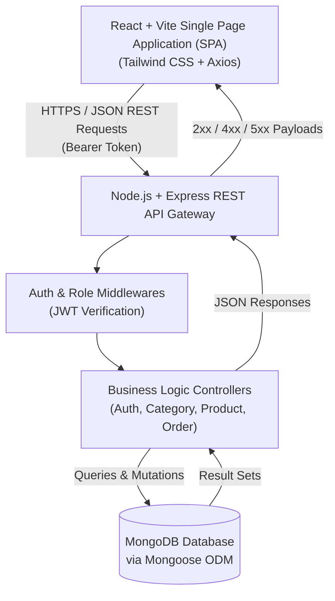
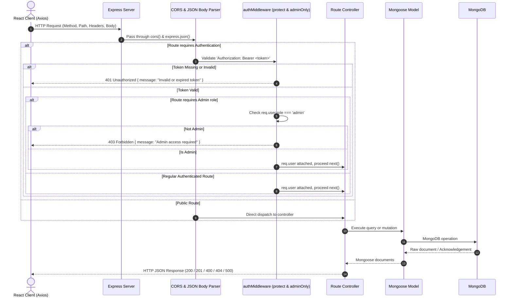
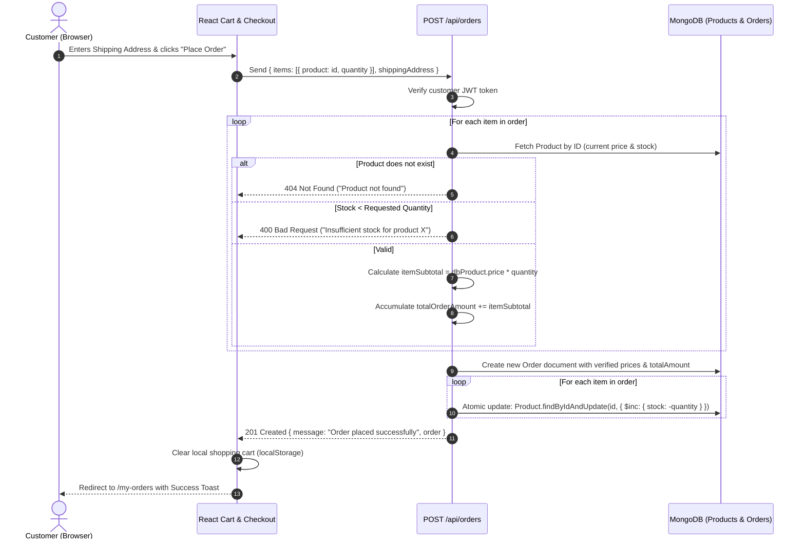

# Architecture & Technical Blueprint

This document details the architectural design, component interactions, security models, and data flows of the **MERN Mini E-Commerce Demo Project**.

---

## 1. High-Level System Architecture

The application adopts a decoupled **Client-Server Architecture**:



---

## 2. Directory Layout & Module Responsibilities

### Backend (`/server`)

```text
server/
├── config/
│   └── db.js                  # MongoDB connection setup using Mongoose
├── controllers/
│   ├── authController.js      # User registration, login, and profile retrieval
│   ├── categoryController.js  # Category CRUD operations
│   ├── productController.js   # Product CRUD, category filtering, and text search
│   └── orderController.js     # Order placement, price validation, stock reduction, status updates
├── middleware/
│   ├── authMiddleware.js      # 'protect' (JWT verification) & 'adminOnly' (role checking)
│   └── errorMiddleware.js     # Centralized 404 and global 500 error handlers
├── models/
│   ├── User.js                # User schema (name, email, password, role)
│   ├── Category.js            # Category schema (name, description)
│   ├── Product.js             # Product schema (name, price, stock, category ref, image)
│   └── Order.js               # Order schema (user ref, products, totalAmount, shipping, status)
├── routes/
│   ├── authRoutes.js          # /api/auth routes
│   ├── categoryRoutes.js      # /api/categories routes
│   ├── productRoutes.js       # /api/products routes
│   └── orderRoutes.js         # /api/orders & /api/admin/orders routes
├── utils/
│   └── generateToken.js       # Helper function to sign JWT with user ID and role
├── .env.example               # Environment variables configuration template
├── package.json               # Server dependencies & scripts
└── server.js                  # Main server entrypoint (Express initialization, routes, listener)
```

### Frontend (`/client`)

```text
client/
├── public/                    # Favicon, static assets
├── src/
│   ├── assets/                # Local images, SVG icons
│   ├── components/
│   │   ├── admin/
│   │   │   ├── AdminLayout.jsx     # Admin wrapper with Sidebar and Topbar
│   │   │   ├── AdminSidebar.jsx    # Navigation links (Dashboard, Categories, Products, Orders)
│   │   │   ├── CategoryModal.jsx   # Create/Edit Category modal dialog
│   │   │   └── ProductModal.jsx    # Create/Edit Product modal dialog
│   │   ├── common/
│   │   │   ├── Navbar.jsx          # Public navbar with search, cart badge, user menu
│   │   │   ├── Footer.jsx          # Simple site footer
│   │   │   ├── ProtectedRoute.jsx  # Route guard for authenticated users
│   │   │   ├── AdminRoute.jsx      # Route guard for admin role
│   │   │   ├── ConfirmationModal.jsx # Delete/action confirmation popup
│   │   │   ├── Toast.jsx           # Success/Error notification alerts
│   │   │   ├── Loader.jsx          # Accessible spinner loading indicator
│   │   │   └── EmptyState.jsx      # Fallback UI for zero products/orders
│   │   └── products/
│   │       ├── ProductCard.jsx     # Product display card with image, price, Add-to-Cart
│   │       ├── ProductGrid.jsx     # Responsive CSS grid for products
│   │       ├── CategoryFilter.jsx  # Horizontal pill filter (All, Electronics, etc.)
│   │       └── SearchBar.jsx       # Real-time search query input
│   ├── context/
│   │   ├── AuthContext.jsx         # Global user state, JWT storage, login/logout actions
│   │   └── CartContext.jsx         # Cart items state, quantity updates, stock guardrails, totals
│   ├── pages/
│   │   ├── admin/
│   │   │   ├── AdminDashboard.jsx  # Overview metrics (count of products, categories, orders)
│   │   │   ├── AdminCategories.jsx # Category list table with Add/Edit/Delete
│   │   │   ├── AdminProducts.jsx   # Product list table with Add/Edit/Delete
│   │   │   └── AdminOrders.jsx     # Order list table with Status updater
│   │   ├── Home.jsx                # Landing page with hero banner & featured catalog
│   │   ├── Products.jsx            # Full catalog with search and category filters
│   │   ├── ProductDetails.jsx      # Detailed item view with stock check & quantity selector
│   │   ├── Cart.jsx                # Cart review, quantity increment/decrement, remove item
│   │   ├── Checkout.jsx            # Cash on Delivery shipping address form
│   │   ├── Login.jsx               # Customer/Admin sign-in form
│   │   ├── Register.jsx            # Customer account registration form
│   │   └── MyOrders.jsx            # Authenticated customer's order history
│   ├── services/
│   │   └── api.js                  # Axios instance with interceptors for Authorization header
│   ├── App.jsx                     # Application router with React Router DOM
│   ├── index.css                   # Tailwind CSS root rules
│   └── main.jsx                    # React 18 DOM mount
├── index.html
├── package.json
├── tailwind.config.js
└── vite.config.js
```

---

## 3. Request Lifecycle & Middleware Architecture

Every incoming API request is handled through a structured middleware pipeline:



---

## 4. Key Workflows & Sequence Diagrams

### 4.1. Order Placement & Server-Side Security Flow
The client **never** dictates product prices or updates stock directly. All calculations and decrements are performed securely on the server.



---

## 5. Security & Validation Architecture

1. **Password Hashing**: Passwords are never stored in plaintext. They are hashed using `bcryptjs` with a cost factor (salt rounds) of `10`.
2. **Stateless JWT Authorization**:
   - Secret key stored in `server/.env`.
   - Token payload: `{ id: user._id, role: user.role }`.
   - Validity: 7 days.
3. **Price Tampering Prevention**:
   - The frontend cart only submits `product ID` and `quantity`.
   - The backend controller independently queries the database for the authoritative unit price of each product.
   - The order `totalAmount` is calculated strictly on the backend.
4. **Stock Guardrails**:
   - Frontend disables quantity increments beyond `product.stock`.
   - Backend checks `product.stock >= quantity` inside `orderController.js` before accepting the order.
   - Negative quantities or non-numeric inputs are rejected with `400 Bad Request`.
5. **Role Separation (RBAC)**:
   - Admin routes (`/api/categories` mutations, `/api/products` mutations, `/api/admin/orders`) require both `protect` and `adminOnly` middlewares.
   - Non-admin attempts to access admin endpoints are blocked with `403 Forbidden`.
