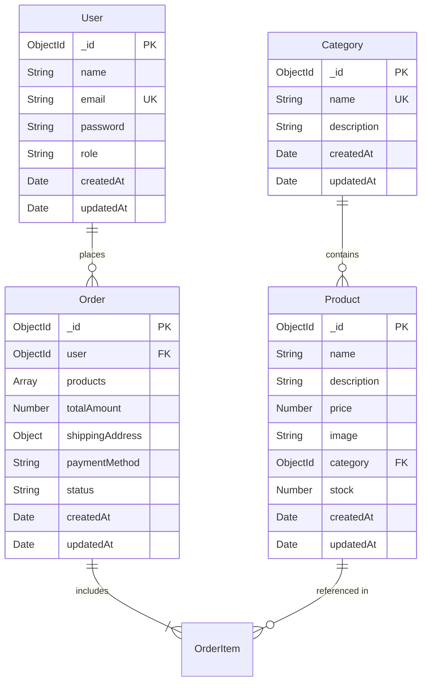

# Database Models & Schema Design

This document details the MongoDB schemas and Mongoose models for the **MERN Mini E-Commerce Demo Project**. 

In strict adherence to the project specification, **only 4 models** are created:
1. `User`
2. `Category`
3. `Product`
4. `Order`

---

## 1. Entity-Relationship Diagram (ERD)



---

## 2. Model Specifications

### 2.1. User Model (`models/User.js`)

Represents customers and administrators.

```javascript
const mongoose = require('mongoose');
const bcrypt = require('bcryptjs');

const userSchema = new mongoose.Schema(
  {
    name: {
      type: String,
      required: [true, 'Please provide a name'],
      trim: true,
      maxlength: [50, 'Name cannot exceed 50 characters'],
    },
    email: {
      type: String,
      required: [true, 'Please provide an email address'],
      unique: true,
      trim: true,
      lowercase: true,
      match: [
        /^\w+([.-]?\w+)*@\w+([.-]?\w+)*(\.\w{2,3})+$/,
        'Please provide a valid email address',
      ],
    },
    password: {
      type: String,
      required: [true, 'Please provide a password'],
      minlength: [6, 'Password must be at least 6 characters long'],
    },
    role: {
      type: String,
      enum: ['customer', 'admin'],
      default: 'customer',
    },
  },
  {
    timestamps: true,
  }
);

// Encrypt password before saving
userSchema.pre('save', async function (next) {
  if (!this.isModified('password')) {
    return next();
  }
  const salt = await bcrypt.genSalt(10);
  this.password = await bcrypt.hash(this.password, salt);
  next();
});

// Instance method to compare password
userSchema.methods.matchPassword = async function (enteredPassword) {
  return await bcrypt.compare(enteredPassword, this.password);
};

module.exports = mongoose.model('User', userSchema);
```

#### Field Attributes
| Field | Type | Required | Constraints / Defaults | Description |
| :--- | :--- | :--- | :--- | :--- |
| `name` | String | Yes | Trimmed, max 50 chars | Full name of user |
| `email` | String | Yes | Unique, lowercase, valid email regex | User's unique sign-in email |
| `password` | String | Yes | Min 6 chars, hashed via bcrypt | Encrypted user password |
| `role` | String | Yes | Enum: `['customer', 'admin']`, default: `'customer'` | User authorization level |
| `createdAt` | Date | Auto | Timestamps enabled | Account creation date |
| `updatedAt` | Date | Auto | Timestamps enabled | Last profile update date |

---

### 2.2. Category Model (`models/Category.js`)

Represents product classifications (e.g., Electronics, Fashion, Shoes).

```javascript
const mongoose = require('mongoose');

const categorySchema = new mongoose.Schema(
  {
    name: {
      type: String,
      required: [true, 'Category name is required'],
      unique: true,
      trim: true,
      maxlength: [40, 'Category name cannot exceed 40 characters'],
    },
    description: {
      type: String,
      trim: true,
      default: '',
    },
  },
  {
    timestamps: true,
  }
);

module.exports = mongoose.model('Category', categorySchema);
```

#### Field Attributes
| Field | Type | Required | Constraints / Defaults | Description |
| :--- | :--- | :--- | :--- | :--- |
| `name` | String | Yes | Unique, trimmed, max 40 chars | Name of category |
| `description` | String | No | Trimmed, default empty string | Optional summary of category |
| `createdAt` | Date | Auto | Timestamps enabled | Creation timestamp |
| `updatedAt` | Date | Auto | Timestamps enabled | Last modification timestamp |

---

### 2.3. Product Model (`models/Product.js`)

Represents catalog items available for browsing and ordering.

```javascript
const mongoose = require('mongoose');

const productSchema = new mongoose.Schema(
  {
    name: {
      type: String,
      required: [true, 'Product name is required'],
      trim: true,
      maxlength: [100, 'Product name cannot exceed 100 characters'],
    },
    description: {
      type: String,
      required: [true, 'Product description is required'],
      trim: true,
    },
    price: {
      type: Number,
      required: [true, 'Product price is required'],
      min: [0, 'Price must be a positive number'],
    },
    image: {
      type: String,
      required: [true, 'Product image URL is required'],
      trim: true,
    },
    category: {
      type: mongoose.Schema.Types.ObjectId,
      ref: 'Category',
      required: [true, 'Product category is required'],
    },
    stock: {
      type: Number,
      required: [true, 'Product stock is required'],
      min: [0, 'Stock cannot be negative'],
      default: 0,
    },
  },
  {
    timestamps: true,
  }
);

// Text index for search functionality
productSchema.index({ name: 'text', description: 'text' });

module.exports = mongoose.model('Product', productSchema);
```

#### Field Attributes
| Field | Type | Required | Constraints / Defaults | Description |
| :--- | :--- | :--- | :--- | :--- |
| `name` | String | Yes | Trimmed, max 100 chars | Display title of item |
| `description` | String | Yes | Trimmed | Detailed product description |
| `price` | Number | Yes | Min: 0 (must be non-negative) | Unit price in local currency |
| `image` | String | Yes | Valid URL string | Web image source URL |
| `category` | ObjectId | Yes | References `Category` model | Foreign key to Category |
| `stock` | Number | Yes | Min: 0, default: 0 | Available inventory count |
| `createdAt` | Date | Auto | Timestamps enabled | Creation timestamp |
| `updatedAt` | Date | Auto | Timestamps enabled | Last modification timestamp |

---

### 2.4. Order Model (`models/Order.js`)

Represents customer orders, snapshots of items at purchase time, shipping details, and fulfillment status.

```javascript
const mongoose = require('mongoose');

const orderSchema = new mongoose.Schema(
  {
    user: {
      type: mongoose.Schema.Types.ObjectId,
      ref: 'User',
      required: [true, 'Order must belong to a user'],
    },
    products: [
      {
        product: {
          type: mongoose.Schema.Types.ObjectId,
          ref: 'Product',
          required: true,
        },
        name: {
          type: String,
          required: true,
        },
        price: {
          type: Number,
          required: true,
          min: 0,
        },
        quantity: {
          type: Number,
          required: true,
          min: [1, 'Quantity must be at least 1'],
        },
        image: {
          type: String,
          required: true,
        },
      },
    ],
    totalAmount: {
      type: Number,
      required: [true, 'Total amount is required'],
      min: [0, 'Total amount cannot be negative'],
    },
    shippingAddress: {
      name: {
        type: String,
        required: [true, 'Recipient name is required'],
      },
      phone: {
        type: String,
        required: [true, 'Phone number is required'],
      },
      address: {
        type: String,
        required: [true, 'Street address is required'],
      },
      city: {
        type: String,
        required: [true, 'City is required'],
      },
      pincode: {
        type: String,
        required: [true, 'Pincode is required'],
      },
    },
    paymentMethod: {
      type: String,
      default: 'Cash on Delivery',
      enum: ['Cash on Delivery'],
    },
    status: {
      type: String,
      enum: ['Pending', 'Confirmed', 'Shipped', 'Delivered', 'Cancelled'],
      default: 'Pending',
    },
    createdAt: {
      type: Date,
      default: Date.now,
    },
  },
  {
    timestamps: true,
  }
);

// Index orders by user for fast retrieval in My Orders
orderSchema.index({ user: 1, createdAt: -1 });

module.exports = mongoose.model('Order', orderSchema);
```

#### Field Attributes
| Field | Type | Required | Constraints / Defaults | Description |
| :--- | :--- | :--- | :--- | :--- |
| `user` | ObjectId | Yes | References `User` model | Customer placing order |
| `products` | Array of Objects | Yes | Non-empty array | Snapshot of items (ID, name, price, qty, image) |
| `totalAmount` | Number | Yes | Min: 0, calculated on server | Sum total of ordered products |
| `shippingAddress` | Subdocument | Yes | All subfields required | Recipient delivery details |
| `shippingAddress.name` | String | Yes | Required | Recipient name |
| `shippingAddress.phone` | String | Yes | Required | Recipient phone number |
| `shippingAddress.address`| String | Yes | Required | Street / apartment address |
| `shippingAddress.city` | String | Yes | Required | Delivery city |
| `shippingAddress.pincode`| String | Yes | Required | Postal / zip code |
| `paymentMethod` | String | Yes | Fixed: `'Cash on Delivery'` | Payment mode |
| `status` | String | Yes | Enum: `Pending`, `Confirmed`, `Shipped`, `Delivered`, `Cancelled` | Lifecycle status of order |
| `createdAt` | Date | Auto | Default: `Date.now` | Order timestamp |

---

## 3. Database Indexes

| Collection | Index Field(s) | Type | Purpose |
| :--- | :--- | :--- | :--- |
| `users` | `{ email: 1 }` | Unique | Prevent duplicate user registration & fast login lookup |
| `categories` | `{ name: 1 }` | Unique | Prevent duplicate category creation |
| `products` | `{ category: 1 }` | Standard | High performance category-based filtering |
| `products` | `{ name: "text", description: "text" }` | Text Index | Keyword product search via query param |
| `orders` | `{ user: 1, createdAt: -1 }` | Compound | Fast chronological retrieval for customer "My Orders" |
| `orders` | `{ createdAt: -1 }` | Standard | Fast chronological order feeds for Admin dashboard |
