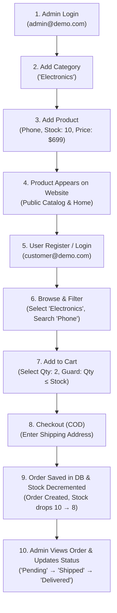

# Demo Flow & Testing Guide

This document provides a complete step-by-step guide for executing the **10-Step Main Demo Flow**, along with comprehensive test scenarios and edge-case verification for the **MERN Mini E-Commerce Demo Project**.

---

## 1. The 10-Step Main Demo Flow

---

## 2. Step-by-Step Execution Walkthrough

### Step 1: Admin Login
- **URL**: `/login`
- **Action**: Enter Admin credentials:
  - **Email**: `admin@demo.com`
  - **Password**: `admin123`
- **Expected Outcome**:
  - Successfully authenticated with JWT token stored in `localStorage`.
  - Redirected to `/admin/dashboard`.
  - Admin sidebar displays navigation links for Dashboard, Categories, Products, and Orders.

---

### Step 2: Add Category
- **URL**: `/admin/categories`
- **Action**:
  - Click the **"+ Add Category"** button.
  - Fill in modal inputs:
    - **Category Name**: `Electronics`
    - **Description**: `Smartphones, Laptops, and Accessories`
  - Click **"Save Category"**.
- **Expected Outcome**:
  - Request sent to `POST /api/categories`.
  - Category appears immediately in the table.
  - Success Toast: *"Category created successfully"*.

---

### Step 3: Add Product
- **URL**: `/admin/products`
- **Action**:
  - Click the **"+ Add Product"** button.
  - Fill in modal inputs:
    - **Product Name**: `Wireless Earbuds Pro`
    - **Description**: `High fidelity noise cancelling bluetooth earbuds`
    - **Price**: `99.99`
    - **Category**: Select `Electronics` from dropdown
    - **Stock**: `15`
    - **Image URL**: `https://images.unsplash.com/photo-1590658268037-6bf12165a8df`
  - Click **"Save Product"**.
- **Expected Outcome**:
  - Request sent to `POST /api/products`.
  - Product added to the table with stock `15`.
  - Success Toast: *"Product created successfully"*.

---

### Step 4: Verify Product Appears on Public Website
- **URL**: `/products` (or `/`)
- **Action**: Navigate to the public storefront.
- **Expected Outcome**:
  - Newly created product *"Wireless Earbuds Pro"* is visible in the product grid.
  - Displays product thumbnail, category pill, name, price `$99.99`, and in-stock badge (`In Stock: 15`).

---

### Step 5: Customer Registration / Login
- **URL**: `/register` (or `/login`)
- **Action**:
  - Click **"Register"** in the top navigation.
  - Fill in registration form:
    - **Name**: `Alice Walker`
    - **Email**: `alice@example.com`
    - **Password**: `alice123`
    - **Confirm Password**: `alice123`
  - Click **"Create Account"**.
- **Expected Outcome**:
  - Customer JWT issued and stored in `localStorage`.
  - User greeting appears in Navbar (`Hello, Alice`).
  - Redirected to home page or product catalog.

---

### Step 6: Browse & Filter Products
- **URL**: `/products`
- **Action**:
  - Click the `Electronics` category filter pill.
  - Type `Earbuds` into the search bar.
- **Expected Outcome**:
  - Query parameters updated: `/products?category=Electronics&search=Earbuds`.
  - Only matching products are rendered in the grid.

---

### Step 7: Add Product to Cart
- **URL**: `/products/:id` (or direct Add from `/products`)
- **Action**:
  - Click on *"Wireless Earbuds Pro"* to open Product Details.
  - Select Quantity: `2`.
  - Click **"Add to Cart"**.
- **Expected Outcome**:
  - Navbar cart counter badge updates from `0` to `2`.
  - Success Toast: *"Added 2 items to your cart"*.
  - Quantity cannot be incremented beyond available stock (15).

---

### Step 8: Proceed to Checkout
- **URL**: `/cart` -> `/checkout`
- **Action**:
  - Navigate to Cart, review line items and total: `$199.98`.
  - Click **"Proceed to Checkout"**.
  - Fill in the Shipping Address form:
    - **Full Name**: `Alice Walker`
    - **Phone**: `+1 555-0144`
    - **Street Address**: `789 Market Street, Suite 400`
    - **City**: `San Francisco`
    - **Pincode**: `94103`
  - Verify payment method displays **Cash on Delivery**.
  - Click **"Place Order"**.
- **Expected Outcome**:
  - Frontend dispatches `POST /api/orders`.

---

### Step 9: Order Stored in MongoDB & Stock Decrement
- **Expected System Outcome**:
  - Backend verifies live price from database ($99.99 * 2 = $199.98).
  - Backend checks stock availability (15 >= 2).
  - New Order document saved in MongoDB with status `Pending`.
  - Product stock is atomically decremented: `15 - 2 = 13`.
  - Shopping cart is cleared in `localStorage`.
  - Customer redirected to `/my-orders` with Success Toast: *"Order placed successfully!"*.
  - The new order appears in Alice's **My Orders** list.

---

### Step 10: Admin Inspects Order & Updates Status
- **URL**: `/admin/orders`
- **Action**:
  - Log out as Alice and log back in as Admin (`admin@demo.com`).
  - Open **Admin Orders** page.
  - Alice's order is listed at the top with:
    - Customer: `Alice Walker (alice@example.com)`
    - Items: `Wireless Earbuds Pro x 2`
    - Total: `$199.98`
    - Status: `Pending`
  - Change status dropdown from `Pending` -> `Shipped`.
  - Later change status to `Delivered`.
- **Expected Outcome**:
  - Request sent to `PATCH /api/admin/orders/:id/status`.
  - Order status badge updates immediately.
  - Alice's view in `/my-orders` reflects updated status `Shipped` / `Delivered`.

---

## 3. Negative & Edge-Case Testing Matrix

| Scenario | Input / Action | Expected Result |
| :--- | :--- | :--- |
| **Duplicate Email** | Registering with already registered email | `400 Bad Request`: *"User with this email already exists"* |
| **Short Password** | Registering with 4-character password | Frontend validation error & `400 Bad Request`: *"Password must be at least 6 characters"* |
| **Password Mismatch** | `password` != `confirmPassword` | Frontend error alert before request submission |
| **Price Tampering** | Manipulating local cart item price in DevTools | Server ignores client price, recalculates total using MongoDB product price |
| **Exceeding Stock** | Attempting to add 20 units when stock is 15 | Increment button disabled; toast warning *"Cannot exceed available stock"* |
| **Concurrent Out of Stock** | Multiple users checkout last item simultaneously | Atomic `$inc: { stock: -qty }` check aborts with `400 Bad Request`: *"Insufficient stock"* |
| **Negative Price/Stock** | Admin enters `-10` for stock or `-5` for price | Backend schema validation rejects with `400 Bad Request` |
| **Non-Admin Admin Route** | Customer requests `GET /api/admin/orders` | `403 Forbidden`: *"Not authorized as an admin"* |
| **Empty Cart Checkout** | Accessing `/checkout` with empty cart | Redirected to `/cart` or `/products` with warning toast |

---

## 4. Acceptance Criteria Checklist

- [x] **Authentication**: JWT token generated on login/register and verified on protected endpoints.
- [x] **Role Access**: Admin routes strictly protected by `adminOnly` middleware.
- [x] **Category Management**: Admin can Add, Edit, Delete, and View categories.
- [x] **Product Management**: Admin can Add, Edit, Delete, and View products with Category reference.
- [x] **Storefront Discovery**: Products filterable by Category and searchable by text.
- [x] **Cart Logic**: Quantity controls enforce upper stock limit and recalculate total price dynamically.
- [x] **Secure Checkout**: Orders use Cash on Delivery; backend validates price and stock before saving.
- [x] **Stock Reduction**: Stock reduces automatically upon order placement.
- [x] **Customer Tracking**: Customer can view order history on `/my-orders`.
- [x] **Order Fulfillment**: Admin can view all customer orders and transition order statuses.
- [x] **Responsive UI**: Tested across Mobile, Tablet, and Desktop screen widths.
